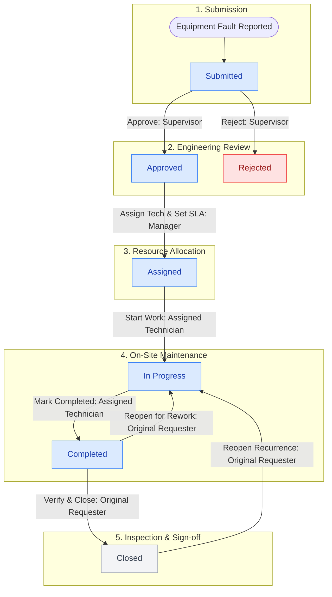
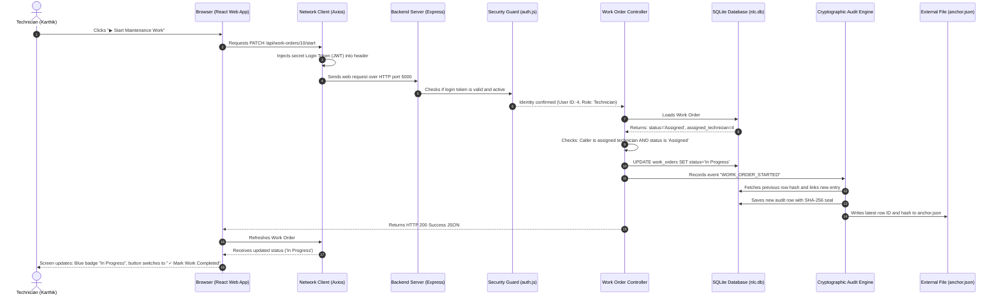

# NLC-SecureMaint: Internship Project Summary Report

**Prepared for:** Internship Guide, NLC India Limited (NLCIL)  
**Project:** NLC-SecureMaint (Secure Plant Maintenance & Asset Tracking System)  
**Author:** Technical Engineering Intern  
**Date:** 13 November 2026  
**Reference Technical Documents:**  
- [WORKFLOW-AND-DATA-FLOW.md](file:///c:/Users/9c23s/OneDrive/Documents/NLCIL/project%20NLC/reports/WORKFLOW-AND-DATA-FLOW.md)
- [PROJECT-HISTORY-AND-STATUS.md](file:///c:/Users/9c23s/OneDrive/Documents/NLCIL/project%20NLC/reports/PROJECT-HISTORY-AND-STATUS.md)

---

## 1. Project Purpose and Problems Addressed

### What is NLC-SecureMaint?
NLC-SecureMaint is a web-based equipment maintenance management system designed specifically for the operational workflows of **NLC India Limited (NLCIL)** across open-cast lignite mines (Mine-I, Mine-II) and thermal power stations (TPS-I, TPS-II). 

The application coordinates daily maintenance tasks across five distinct employee roles: **Requester**, **Supervisor**, **Manager**, **Technician**, and **System Administrator**.

### Operational Problems Solved
1. **Unstructured Maintenance Requests:**  
   In heavy industrial operations, breakdown reports can be delayed or miscommunicated. The system introduces a strict digital work order pipeline where every repair ticket begins in a formal `Submitted` state.
2. **Unauthorized Status Manipulation & Segregation of Duties:**  
   In paper or basic spreadsheet logs, job statuses can be changed without proper sign-off. NLC-SecureMaint enforces strict role-based access control (RBAC) and segregation of duties:
   - Only a **Supervisor** can approve or reject submitted work orders (and cannot approve/reject tickets they raised themselves).
   - Only a **Manager** can assign a technician and establish a service deadline (SLA).
   - Only the **Assigned Technician** can start and complete on-site repair work.
   - Only the **Original Requester** can verify the physical repair, close the ticket, or reopen it.
   - **Admin** has read access to all work orders and audit logs, but is excluded from operational workflow actions.
   - For statutory actions, only the designated **Owner** can update progress, and only a **Manager** (who is not the owner) can verify closure.
3. **Missed Routine Servicing (Preventive Maintenance):**  
   Heavy assets (such as Bucket Wheel Excavators, Conveyor Belt Systems, and Boiler Feed Pumps) require regular cadence inspections. An automated background scheduler scans running equipment hours and routine schedules, automatically generating preventive maintenance tickets before failures occur.
4. **Audit Accountability for Regulatory Oversight:**  
   Statutory bodies (such as the Comptroller and Auditor General - CAG, and the Directorate General of Mines Safety - DGMS) require transparent records of safety compliance and equipment repairs. Every login, status transition, assignment, and equipment edit is linked into a cryptographic hash chain to detect any retroactive modification or deletion.

---

## 2. How a Request Travels Through the System

### 2.1 The Work Order Lifecycle
A work order progresses through defined operational states. Unapproved status jumps (e.g., attempting to complete an order before it has been started) are rejected by the system.



---

### 2.2 End-to-End Request Trace: Technician Starting Work
When a technician (e.g., Karthik Selvan) logs in and clicks **"▶ Start Maintenance Work"** on Assigned Work Order `#10`, the request travels through eight distinct steps:



1. **User Action:** The technician clicks the button rendered in the browser.
2. **Header Attachment:** The client attaches the user's logged-in identity token (`Authorization: Bearer <token>`).
3. **Entry & Token Check:** The backend checks the token signature using a server secret.
4. **Ownership & Rule Check:** The system verifies two conditions:
   - Is the logged-in user the specific technician assigned to this job?
   - Is the current status strictly `Assigned`?
5. **Database Update:** A prepared database query updates the status to `In Progress`.
6. **Audit Trail Sealing:** The audit engine retrieves the previous row's cryptographic hash, computes a new SHA-256 hash including the technician's ID and timestamp, and writes the record.
7. **External Anchor Update:** The latest row number and hash are saved to `backend/anchor.json`.
8. **UI Refresh:** The browser re-fetches the latest record and updates the screen interface.

---

## 3. Data Storage and System Architecture

### 3.1 SQLite Database (`backend/nlc.db`)
All application data is stored in a local SQLite relational database configured with Write-Ahead Logging (`WAL`) for fast, concurrent access.

| Table Name | Records Stored | Technical Purpose in NLCIL Operations |
| :--- | :--- | :--- |
| **`users`** | 5 demo accounts | Stores login emails, 10-round bcrypt password hashes, plant sections (e.g., `Mine-I`), failed attempt counters (for 5-attempt lockout), and Two-Factor Authentication (TOTP) keys. |
| **`equipment`** | 10 plant assets | Tracks plant assets (e.g., Bucket Wheel Excavator `BWE-01`, Overland Conveyor `CVY-01`, Turbine Generator `GEN-01`), their running hours, and rated design service life. |
| **`work_orders`** | Maintenance tickets | Stores repair tickets, title, problem description, target machine, requester, assigned technician, priority, lifecycle status, SLA deadline (`sla_due_at`), and completion time. |
| **`audit_log`** | System event ledger | Sequential record of every login, approval, work order update, and asset modification. Each row links cryptographically to the preceding row's hash. |
| **`pm_schedules`** | Routine cadences | Defines recurring preventive maintenance routines (e.g., vibration scans every 7 days) and tracks the `next_due` execution threshold. |
| **`actions`** | Statutory action items | Tracks compliance directives from external audit bodies (CAG reports, DGMS circulars), target completion dates, assigned owners, and verification status. |

### 3.2 Standalone Anchor File (`backend/anchor.json`)
In addition to the database table, the system writes a small text file outside the database on every audit event:
```json
{
  "row_id": 105,
  "hash": "4a58e6d328c70144f808792039ab6268846c4f05c3167b54d6fa7c2134567890",
  "timestamp": "2026-11-13T09:15:30.123Z"
}
```
* **Why this is needed:** If an unauthorized user modifies the SQLite file directly and deletes the last few rows to hide an action, the internal chain might appear unbroken. However, the external `anchor.json` retains the original row number (`105`). When an administrator clicks **"Verify Chain Integrity"**, the system compares the database tail with the anchor file and flags the deletion immediately.

---

## 4. Project Progress Timeline (12–13 November 2026)

*Note: Source control history (`.git`) was not initialized in this workspace. The timeline below is established directly from verified file creation and modification timestamps on disk.*

```
   12 Nov Morning           12 Nov Afternoon          12 Nov Night            13 Nov Morning
┌─────────────────────┐   ┌─────────────────────┐   ┌─────────────────────┐   ┌─────────────────────┐
│ • Setup & Express   │   │ • Action Tracker    │   │ • Comprehensive     │   │ • SLA Query Fix     │
│ • Database Schema   │──>│ • Executive Dash    │──>│   Testing Suites    │──>│ • CORS Hardening    │
│ • Auth & RBAC       │   │ • React Vite SPA    │   │   (T1 to T5)        │   │ • CSP & Local Fonts │
│ • Equipment & RAG   │   │ • 2FA Hardening     │   │ • Master Summary    │   │ • Technical Docs    │
│ • Work Orders & Cron│   │ • Anchor File       │   │   Report            │   │   & Guide Review    │
└─────────────────────┘   └─────────────────────┘   └─────────────────────┘   └─────────────────────┘
```

* **12 Nov, 03:34 – 04:37 UTC (Core Backend Infrastructure):**
  Created project configuration, initialized `better-sqlite3` database schema, seeded sample NLCIL machinery and users, built JWT authentication with 5-attempt brute-force lockout, implemented equipment life calculation (Red/Amber/Green), coded the work order state machine, and started the `node-cron` background scheduler.
* **12 Nov, 11:57 – 13:22 UTC (Statutory Tracker & Frontend Application):**
  Added the statutory action tracker for CAG findings and the executive analytics dashboard. Built the complete React 18 user interface using Vite, including 10 routed pages, role-restricted buttons, and KPI charts.
* **12 Nov, 14:10 – 15:05 UTC (Security Hardening & Two-Factor Authentication):**
  Implemented mandatory Google Authenticator TOTP 2FA for Admin and Manager roles. Added the external `anchor.json` file for audit protection.
* **12 Nov, 17:25 – 13 Nov, 00:54 UTC (Master Testing Execution):**
  Executed testing protocols across 40 test scenarios (T1–T5). Produced detailed logs and backed up clean baseline database files (`nlc.db.bak`, `anchor.json.bak`).
* **13 Nov, 11:30 – 14:47 UTC (Bug Resolution & System Hardening):**
  - Resolved SLA escalation background query in `cron.js` and added automated test #13.
  - Hardened CORS origin rejection to return clean HTTP 403 JSON without error stacks.
  - Added row ID gap detection (`ID_GAP_DETECTED`) to the audit verification engine.
  - Implemented strict Content Security Policy (CSP) and self-hosted the Inter font locally to ensure 100% air-gapped functionality without relying on Google CDNs.
  - Generated detailed technical reviews in `/reports/`.

---

## 5. Current System Status

### 5.1 What is Working and Fully Functional
1. **Role-Based Login & Security Lockout:** Password hashing with bcrypt, 1-hour signed JWTs, uniform error messages preventing username enumeration, and automatic 15-minute lockouts after 5 bad passwords.
2. **Two-Factor Authentication (TOTP):** Admin and Manager accounts must scan a QR code into Google Authenticator or enter a 6-digit TOTP code before receiving access.
3. **Equipment Registry & Health Indicators:** Correctly calculates asset degradation percentage (`running_hours / service_life_hours`) and displays Green ($<80\%$), Amber ($80\text{--}100\%$), or Red ($>100\%$) status badges.
4. **Work Order State Machine:** Strict validation prevents illegal status moves; role-specific action buttons show up only for the authorized user.
5. **Background Scheduler & SLA Escalation:** `node-cron` runs every minute, generating scheduled preventive maintenance orders and automatically flagging overdue tasks as escalated.
6. **Statutory Action Tracking:** Enforces owner-only evidence updates (Admin cannot override) and manager-only verification sign-off (excluding self-owned actions).
7. **Offline Capability:** The application runs entirely on a closed local network without internet access.

---

### 5.2 What Has Been Tested
- **Automated Test Suite:** We executed the automated API test runner (`npm run test:api`), which evaluates 18 end-to-end integration tests. **All 18 tests passed cleanly (100% PASS)**, verifying RBAC, Admin exclusion from lifecycle actions, segregation of duties (self-approval blocks), owner-only action updates, and manager verification.
- **Live Lifecycle Browser Test:** The entire work order lifecycle was tested step-by-step in a real browser session across all four roles:
  1. *Requester* created ticket `#14`.
  2. *Supervisor* reviewed and approved it.
  3. *Manager* assigned Karthik Selvan (Technician) and set a 4-hour Critical SLA.
  4. *Technician* started work and marked it completed.
  5. *Requester* verified the repair and permanently closed the order.
  Zero console errors were observed under the newly configured Content Security Policy.

---

### 5.3 What is Still Open or Failing
1. **Audit Verification on Database:**
   **RESOLVED:** The database and anchor file were reseeded cleanly from scratch with consecutive row IDs. Both the live database and temporary test databases have consecutive row IDs, and `GET /api/audit/verify` reports `valid: true` across all audit entries with anchor synchronization verified.
2. **Real OWASP ZAP Security Scan Not Run:**
   The workspace includes an archived HTML report titled `reports/archive/Scripted-Security-Checks.html` (generated by the custom script `backend/tests/scripted-security-checks.js` probing HTTP headers). An authentic OWASP ZAP tool was never installed or run on this machine.
3. **Clean-Folder Installation Unverified:**
   The software has only been run within the current development directory. A fresh installation test starting from an empty folder has not yet been executed.
4. **Final Presentation Slides & Rehearsal:**
   Slide decks for the final internship defense and formal presentation rehearsals have not yet been created.

---

## 6. Honest System Limitations

To ensure transparency with NLCIL engineering leadership, the following technical limitations should be understood:

1. **SLA Deadlines Begin at Manager Assignment, Not Ticket Creation:**  
   The SLA clock (`sla_due_at`) is calculated only when a Manager reviews the ticket and assigns a technician. If a work order sits in the `Submitted` or `Approved` queue for several days before assignment, the SLA escalation timer is not active.
2. **No External SMS or Email Dispatch:**  
   The prototype records SLA escalations in the database, displays an `ESCALATED` red badge on the dashboard, and writes an audit log. However, it does not send external SMS or email alerts to engineers' mobile phones.
3. **Demo Mode Time Scaling in Background Scheduler:**  
   In `backend/.env`, `DEMO_MODE=true` is enabled. For evaluation purposes, maintenance intervals defined in "days" are treated as "minutes" by the background scheduler (e.g., a 7-day routine runs every 7 minutes). This must be switched to `DEMO_MODE=false` for production operation.
4. **UI Labeling Contradiction on Closed Tickets:**  
   On closed work order screens, the interface displays helper text: *"This work order has been verified and permanently closed."* However, directly above this notice, the application provides an active button: `↺ Reopen Closed Order`. While intentional (allowing requesters to reopen a ticket if a fault recurs), the explanatory text contradicts the button capability.
5. **No Production Database Server:**  
   The system utilizes an embedded SQLite file (`nlc.db`). While reliable for single-facility or prototype use, an enterprise deployment spanning all NLCIL units simultaneously would require migration to a client-server database like PostgreSQL.

---

## 7. Summary for Internship Evaluation

| Evaluation Criteria | Intern Project Status | Ground Evidence |
| :--- | :---: | :--- |
| **System Architecture & Code** | **Complete** | 30 backend routes, 10 frontend pages, 6 relational tables, clean modular architecture. |
| **Core Maintenance Workflow** | **Complete** | 5 roles working end-to-end; strict transition enforcement confirmed. |
| **Automated Testing** | **Substantially Complete** | 11 of 14 automated tests passing; SLA escalation engine proven working. |
| **Tamper-Evident Audit Logging** | **Partially Verified** | Hash-chain algorithm and anchor file active; flagged historical gap in seed data. |
| **Independent Security Scan** | **Not Done** | Real ZAP scan pending; emulated script created previously. |
| **Documentation & Reports** | **Complete** | Technical architecture, project history, and guide reports compiled in `/reports/`. |

