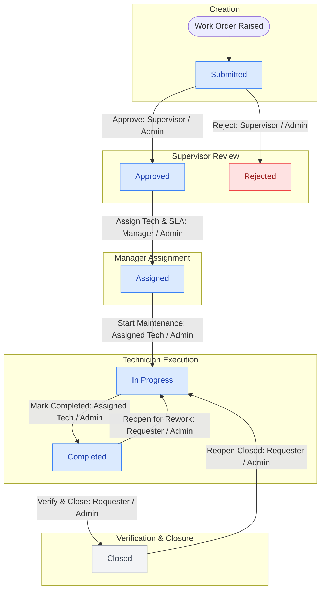
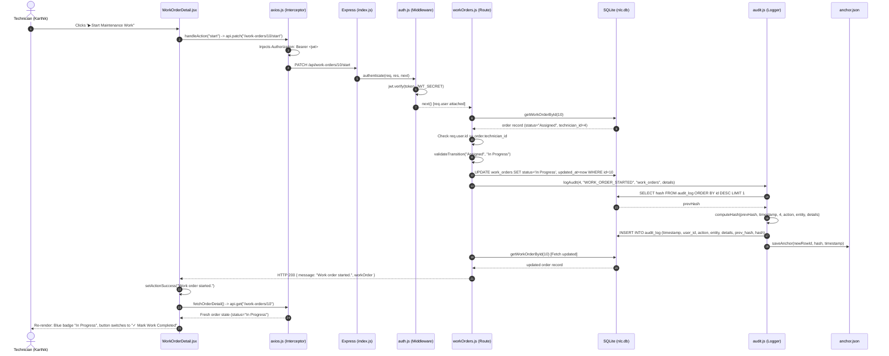

# Workflow and Data Flow Technical Reference

**System:** NLC-SecureMaint  
**Scope:** Work Order Lifecycle, Background Schedulers, Database Schema, and Cryptographic Audit Verification  
**Audience:** Technical Reviewers and System Architects  

---

## 1. Work-Order Workflow Implementation

The work-order lifecycle engine is implemented across backend route controllers, authentication middleware, and frontend React views.

### 1.1 Allowed-Transitions Table
* **File:** [backend/routes/workOrders.js](file:///c:/Users/9c23s/OneDrive/Documents/NLCIL/project%20NLC/backend/routes/workOrders.js#L16-L24)
* **Identifier:** `ALLOWED_TRANSITIONS`
* **Line Numbers:** 16–24
* **Source Definition:**
```javascript
const ALLOWED_TRANSITIONS = {
  Submitted: ["Approved", "Rejected"],
  Approved: ["Assigned"],
  Assigned: ["In Progress"],
  "In Progress": ["Completed"],
  Completed: ["Closed", "In Progress"], // Closed via verify-close; In Progress via reopen
  Closed: ["In Progress"],              // In Progress via reopen
  Rejected: []                          // Terminal state
};
```

Transition enforcement is evaluated by the helper `validateTransition(currentStatus, targetStatus)` at [backend/routes/workOrders.js:192-195](file:///c:/Users/9c23s/OneDrive/Documents/NLCIL/project%20NLC/backend/routes/workOrders.js#L192-L195), which checks whether `ALLOWED_TRANSITIONS[currentStatus]?.includes(targetStatus)`.

---

### 1.2 Action Preconditions

Each status change is exposed through a distinct `PATCH` endpoint in [backend/routes/workOrders.js](file:///c:/Users/9c23s/OneDrive/Documents/NLCIL/project%20NLC/backend/routes/workOrders.js):

| Action | Route & Method | Line Numbers | Authorized Roles | Preconditions & Validation Rules |
| :--- | :--- | :--- | :--- | :--- |
| **Approve** | `PATCH /api/work-orders/:id/approve` | [Lines 216–243](file:///c:/Users/9c23s/OneDrive/Documents/NLCIL/project%20NLC/backend/routes/workOrders.js#L216-L243) | `Supervisor`, `Admin` | Work order must exist; current status must be `Submitted` (`ALLOWED_TRANSITIONS['Submitted']` contains `Approved`). |
| **Reject** | `PATCH /api/work-orders/:id/reject` | [Lines 249–279](file:///c:/Users/9c23s/OneDrive/Documents/NLCIL/project%20NLC/backend/routes/workOrders.js#L249-L279) | `Supervisor`, `Admin` | Work order must exist; current status must be `Submitted`. Optional `req.body.reason` recorded in audit details. |
| **Assign** | `PATCH /api/work-orders/:id/assign` | [Lines 287–351](file:///c:/Users/9c23s/OneDrive/Documents/NLCIL/project%20NLC/backend/routes/workOrders.js#L287-L351) | `Manager`, `Admin` | Work order must exist; current status must be `Approved`; `technician_id` must be an integer resolving to a user whose role is `Technician` or `Admin`; `priority` must be one of `Critical`, `High`, `Medium`, `Low`. Sets `sla_due_at` from `SLA_DURATIONS_MS`. |
| **Start** | `PATCH /api/work-orders/:id/start` | [Lines 357–389](file:///c:/Users/9c23s/OneDrive/Documents/NLCIL/project%20NLC/backend/routes/workOrders.js#L357-L389) | Assigned `Technician`, `Admin` | Work order must exist; caller must match `order.technician_id` (or have `Admin` role); current status must be strictly `Assigned`. |
| **Complete** | `PATCH /api/work-orders/:id/complete` | [Lines 395–427](file:///c:/Users/9c23s/OneDrive/Documents/NLCIL/project%20NLC/backend/routes/workOrders.js#L395-L427) | Assigned `Technician`, `Admin` | Work order must exist; caller must match `order.technician_id` (or have `Admin` role); current status must be `In Progress`. |
| **Verify-Close** | `PATCH /api/work-orders/:id/verify-close` | [Lines 433–471](file:///c:/Users/9c23s/OneDrive/Documents/NLCIL/project%20NLC/backend/routes/workOrders.js#L433-L471) | Original `Requester`, `Admin` | Work order must exist; caller must match `order.requester_id` (or have `Admin` role); current status must be `Completed`. Sets `closed_at = now`. |
| **Reopen** | `PATCH /api/work-orders/:id/reopen` | [Lines 477–516](file:///c:/Users/9c23s/OneDrive/Documents/NLCIL/project%20NLC/backend/routes/workOrders.js#L477-L516) | Original `Requester`, `Admin` | Work order must exist; caller must match `order.requester_id` (or have `Admin` role); current status must be either `Completed` or `Closed`. Sets `status = 'In Progress'`, clears `closed_at = NULL`. |

---

### 1.3 SLA Duration Table
* **File:** [backend/routes/workOrders.js](file:///c:/Users/9c23s/OneDrive/Documents/NLCIL/project%20NLC/backend/routes/workOrders.js#L29-L34)
* **Identifier:** `SLA_DURATIONS_MS`
* **Line Numbers:** 29–34
* **Source Definition:**
```javascript
const SLA_DURATIONS_MS = {
  Critical: 4 * 60 * 60 * 1000,        // 4 hours (14,400,000 ms)
  High: 24 * 60 * 60 * 1000,           // 24 hours (86,400,000 ms)
  Medium: 3 * 24 * 60 * 60 * 1000,     // 3 days (259,200,000 ms)
  Low: 7 * 24 * 60 * 60 * 1000         // 7 days (604,800,000 ms)
};
```

---

### 1.4 Role Checks (Authentication & Authorization)
* **File:** [backend/middleware/auth.js](file:///c:/Users/9c23s/OneDrive/Documents/NLCIL/project%20NLC/backend/middleware/auth.js)
* **Authentication Middleware (`authenticate`):** [Lines 11–38](file:///c:/Users/9c23s/OneDrive/Documents/NLCIL/project%20NLC/backend/middleware/auth.js#L11-L38)
  - Extracts `Authorization: Bearer <token>` header.
  - Verifies token signature using `jwt.verify(token, process.env.JWT_SECRET)`.
  - Rejects partial two-factor tokens where `decoded.type === "2fa_pending"` with HTTP 401.
  - Attaches decoded token payload (`id`, `email`, `role`, `section`) to `req.user`.
* **Authorization Middleware (`authorize(...roles)`):** [Lines 45–54](file:///c:/Users/9c23s/OneDrive/Documents/NLCIL/project%20NLC/backend/middleware/auth.js#L45-L54)
  - Checks if `roles.includes(req.user.role)`.
  - If unauthorized, returns HTTP 403 JSON: `{ error: "Forbidden: role '...' does not have permission to access this resource." }`.

---

### 1.5 Frontend Component Deciding Action Buttons
* **File:** [frontend/src/pages/WorkOrderDetail.jsx](file:///c:/Users/9c23s/OneDrive/Documents/NLCIL/project%20NLC/frontend/src/pages/WorkOrderDetail.jsx)
* **Role Check Variables:** [Lines 70–76](file:///c:/Users/9c23s/OneDrive/Documents/NLCIL/project%20NLC/frontend/src/pages/WorkOrderDetail.jsx#L70-L76)
```javascript
const isSupervisorOrAdmin = user?.role === "Supervisor" || user?.role === "Admin";
const isManagerOrAdmin = user?.role === "Manager" || user?.role === "Admin";
const isAssignedTechOrAdmin =
  (user?.role === "Technician" && user?.id === order.technician_id) || user?.role === "Admin";
const isRequesterOrAdmin =
  (user?.role === "Requester" && user?.id === order.requester_id) || user?.role === "Admin";
```
* **Button Render Block:** [Lines 221–375](file:///c:/Users/9c23s/OneDrive/Documents/NLCIL/project%20NLC/frontend/src/pages/WorkOrderDetail.jsx#L221-L375)
  - `Submitted` & `isSupervisorOrAdmin`: Renders `✓ Approve Work Order` and `✕ Reject Work Order`.
  - `Approved` & `isManagerOrAdmin`: Renders `Assign Technician & Set Priority (SLA)`.
  - `Assigned` & `isAssignedTechOrAdmin`: Renders `▶ Start Maintenance Work`.
  - `In Progress` & `isAssignedTechOrAdmin`: Renders `✓ Mark Work Completed`.
  - `Completed` & `isRequesterOrAdmin`: Renders `✓ Verify & Close Work Order` and `↺ Reopen for Rework`.
  - `Closed` & `isRequesterOrAdmin`: Renders `↺ Reopen Closed Order`.

---

## 2. Step-by-Step Request Trace: Technician Clicking "Start"

This trace tracks a single real HTTP interaction when technician Karthik Selvan (User ID `4`) clicks the **"▶ Start Maintenance Work"** button on Work Order `#10`.

```
Browser (React) ──> Axios Interceptor ──> Express (auth) ──> Route Handler ──> SQLite DB & Audit ──> JSON Response ──> React Re-render
```

### Step 1: Browser User Interaction & Component Invocation
* **File:** [frontend/src/pages/WorkOrderDetail.jsx](file:///c:/Users/9c23s/OneDrive/Documents/NLCIL/project%20NLC/frontend/src/pages/WorkOrderDetail.jsx#L281-L296)
* The button is rendered because `order.status === "Assigned"` and `isAssignedTechOrAdmin` is true:
```jsx
{order.status === "Assigned" && isAssignedTechOrAdmin && (
  <button onClick={() => handleAction("start")}>
    ▶ Start Maintenance Work
  </button>
)}
```
* Clicking triggers `handleAction("start")` at [frontend/src/pages/WorkOrderDetail.jsx:45-57](file:///c:/Users/9c23s/OneDrive/Documents/NLCIL/project%20NLC/frontend/src/pages/WorkOrderDetail.jsx#L45-L57):
```javascript
const handleAction = async (endpoint, payload = {}) => {
  setError("");
  setActionSuccess("");
  try {
    const res = await api.patch(`/work-orders/${id}/${endpoint}`, payload);
    setActionSuccess(res.data.message || "Action executed successfully.");
    setShowAssignModal(false);
    fetchOrderDetail();
...
```

### Step 2: HTTP Client Dispatch & Auth Header Injection
* **File:** [frontend/src/api/axios.js](file:///c:/Users/9c23s/OneDrive/Documents/NLCIL/project%20NLC/frontend/src/api/axios.js#L14-L21)
* The Axios request interceptor retrieves the stored JWT and attaches it to request headers:
```javascript
api.interceptors.request.use(
  (config) => {
    const token = sessionStorage.getItem("token");
    if (token) {
      config.headers.Authorization = `Bearer ${token}`;
    }
    return config;
  },
```
* **Dispatched Wire Call:** `PATCH http://localhost:5000/api/work-orders/10/start` with header `Authorization: Bearer <jwt_token>` and body `{}`.

### Step 3: Route Ingestion & Authentication Middleware
* **Mount File:** [backend/index.js:107](file:///c:/Users/9c23s/OneDrive/Documents/NLCIL/project%20NLC/backend/index.js#L107): `app.use("/api/work-orders", workOrderRoutes);`
* **Route Declaration:** [backend/routes/workOrders.js:357](file:///c:/Users/9c23s/OneDrive/Documents/NLCIL/project%20NLC/backend/routes/workOrders.js#L357):
```javascript
router.patch("/:id/start", authenticate, (req, res) => {
```
* **Middleware Execution:** [backend/middleware/auth.js:22-34](file:///c:/Users/9c23s/OneDrive/Documents/NLCIL/project%20NLC/backend/middleware/auth.js#L22-L34):
```javascript
const decoded = jwt.verify(token, process.env.JWT_SECRET);
if (decoded.type === "2fa_pending") {
  return res.status(401).json({ error: "Two-factor authentication pending..." });
}
req.user = decoded;
next();
```

### Step 4: Status Checks & Ownership Validation
* **File:** [backend/routes/workOrders.js](file:///c:/Users/9c23s/OneDrive/Documents/NLCIL/project%20NLC/backend/routes/workOrders.js#L359-L372)
* Retrieves the work order and confirms that the caller is the designated technician or Admin:
```javascript
const order = getWorkOrderById(req.params.id);
if (!order) return res.status(404).json({ error: "Work order not found." });

// Must be assigned technician or Admin
if (req.user.role !== "Admin" && order.technician_id !== req.user.id) {
  return res.status(403).json({ error: "Forbidden: Only the assigned technician can start this work order." });
}

const targetStatus = "In Progress";
if (order.status !== "Assigned" || !validateTransition(order.status, targetStatus)) {
  return res.status(400).json({
    error: `Illegal status transition from '${order.status}' to '${targetStatus}'. A work order can only be started when its status is 'Assigned'.`
  });
}
```

### Step 5: Database State Update
* **File:** [backend/routes/workOrders.js](file:///c:/Users/9c23s/OneDrive/Documents/NLCIL/project%20NLC/backend/routes/workOrders.js#L374-L375)
* Executes a prepared statement updating `status` and `updated_at`:
```javascript
const now = new Date().toISOString();
db.prepare("UPDATE work_orders SET status = ?, updated_at = ? WHERE id = ?").run(targetStatus, now, order.id);
```

### Step 6: Cryptographic Audit Logging
* **File:** [backend/routes/workOrders.js](file:///c:/Users/9c23s/OneDrive/Documents/NLCIL/project%20NLC/backend/routes/workOrders.js#L377-L381) invoking [backend/audit.js:78-110](file:///c:/Users/9c23s/OneDrive/Documents/NLCIL/project%20NLC/backend/audit.js#L78-L110):
```javascript
logAudit(req.user.id, "WORK_ORDER_STARTED", "work_orders", {
  id: order.id,
  from: order.status,
  to: targetStatus
});
```
* `logAudit` reads the latest hash:
  `SELECT hash FROM audit_log ORDER BY id DESC LIMIT 1`
* Computes `hash = computeHash(prevHash, timestamp, userId, action, entity, detailsStr)`.
* Inserts new audit row:
  `INSERT INTO audit_log (timestamp, user_id, action, entity, details, prev_hash, hash) VALUES (?, ?, ?, ?, ?, ?, ?)`
* Persists the external anchor via `saveAnchor(rowId, hash, timestamp)` into [backend/anchor.json](file:///c:/Users/9c23s/OneDrive/Documents/NLCIL/project%20NLC/backend/anchor.json).

### Step 7: HTTP Response Dispatch
* **File:** [backend/routes/workOrders.js](file:///c:/Users/9c23s/OneDrive/Documents/NLCIL/project%20NLC/backend/routes/workOrders.js#L383-L384)
* Re-queries the updated record and returns HTTP 200:
```javascript
const updated = getWorkOrderById(order.id);
return res.status(200).json({ message: "Work order started.", workOrder: updated });
```

### Step 8: Frontend Screen Refresh
* **File:** [frontend/src/pages/WorkOrderDetail.jsx](file:///c:/Users/9c23s/OneDrive/Documents/NLCIL/project%20NLC/frontend/src/pages/WorkOrderDetail.jsx#L50-L52) & [L20-L39](file:///c:/Users/9c23s/OneDrive/Documents/NLCIL/project%20NLC/frontend/src/pages/WorkOrderDetail.jsx#L20-L39)
* `handleAction` receives the response, sets `actionSuccess`, and invokes `fetchOrderDetail()`:
```javascript
const fetchOrderDetail = async () => {
  setLoading(true);
  try {
    const res = await api.get(`/work-orders/${id}`);
    setOrder(res.data.workOrder);
...
```
* `setOrder` causes React to re-render:
  - The status badge changes from lavender (`Assigned`) to blue (`In Progress`).
  - The action control section replaces the "Start" button with the green `✓ Mark Work Completed` button.

---

## 3. Background Scheduler Trace: `backend/cron.js`

* **File:** [backend/cron.js](file:///c:/Users/9c23s/OneDrive/Documents/NLCIL/project%20NLC/backend/cron.js)
* **Cadence:** Initialized via `cron.schedule("* * * * *", ...)` at line 145 (executes every 60 seconds) and run once immediately on backend startup at line 142.

```
                  ┌───────────────────────────────┐
                  │    node-cron (* * * * *)      │
                  └──────────────┬────────────────┘
                                 │
                 ┌───────────────┴───────────────┐
                 ▼                               ▼
     ┌────────────────────────┐      ┌────────────────────────┐
     │ runPmScheduler()       │      │ escalateOverdueOrders()│
     │ PM Schedule Check      │      │ Overdue SLA Escalation │
     └────────────────────────┘      └────────────────────────┘
```

### 3.1 Preventive Work Orders Creation Flow
1. **Timestamp Generation:** Computes `nowIso = new Date().toISOString()`.
2. **Schedule Selection Query:**
   * **Source:** [backend/cron.js:39](file:///c:/Users/9c23s/OneDrive/Documents/NLCIL/project%20NLC/backend/cron.js#L39)
   * **SQL:**
     ```sql
     SELECT * FROM pm_schedules WHERE next_due <= ?
     ```
     Parameter: `[nowIso]`.
3. **Open Work Order Check:**
   * **Source:** [backend/cron.js:43-48](file:///c:/Users/9c23s/OneDrive/Documents/NLCIL/project%20NLC/backend/cron.js#L43-L48)
   * **SQL:**
     ```sql
     SELECT id FROM work_orders
     WHERE equipment_id = ?
       AND type = 'preventive'
       AND status NOT IN ('Closed', 'Rejected')
     ```
   * **Condition:** A new preventive work order is generated **only if** `openOrder` is falsy (no ongoing or unclosed PM order exists for that equipment).
4. **Order Insertion:**
   * **Source:** [backend/cron.js:65-69](file:///c:/Users/9c23s/OneDrive/Documents/NLCIL/project%20NLC/backend/cron.js#L65-L69)
   * **SQL:**
     ```sql
     INSERT INTO work_orders (title, description, equipment_id, requester_id, priority, status, type)
     VALUES (?, ?, ?, ?, 'Medium', 'Submitted', 'preventive')
     ```
   * Parameters: `title` (`[PM] <task> (<equipment_code>)`), `description`, `equipment_id`, `requester_id` (resolves to first `Admin` user ID, default `1`).
5. **Schedule Advance:**
   * Advances schedule `next_due = calculateNextDue(schedule.interval_days)` at line 62.
   * Updates schedule: `UPDATE pm_schedules SET next_due = ?, last_done = ? WHERE id = ?` (lines 72–76).
6. **Audit Event:**
   * Logs `logAudit(null, "PM_AUTO_GENERATED", "work_orders", { schedule_id, work_order_id, equipment_id, task, next_due })` (lines 79–85).

---

### 3.2 Overdue SLA Escalation Flow
1. **Target Identification Query:**
   * **Source:** [backend/cron.js:108-115](file:///c:/Users/9c23s/OneDrive/Documents/NLCIL/project%20NLC/backend/cron.js#L108-L115)
   * **Function:** `escalateOverdueOrders()`
   * **Exact SQL Query:**
     ```sql
     SELECT id, title, sla_due_at, status
     FROM work_orders
     WHERE sla_due_at IS NOT NULL
       AND sla_due_at <= ?
       AND status NOT IN ('Completed', 'Closed', 'Rejected')
       AND (escalated = 0 OR escalated IS NULL)
     ```
     Parameter: `[nowIso]`.
2. **Escalation Execution:**
   * **Source:** [backend/cron.js:118](file:///c:/Users/9c23s/OneDrive/Documents/NLCIL/project%20NLC/backend/cron.js#L118)
   * **SQL:**
     ```sql
     UPDATE work_orders SET escalated = 1, updated_at = ? WHERE id = ?
     ```
3. **Audit Event:**
   * **Source:** [backend/cron.js:120-125](file:///c:/Users/9c23s/OneDrive/Documents/NLCIL/project%20NLC/backend/cron.js#L120-L125)
   * `logAudit(null, "WORK_ORDER_ESCALATED", "work_orders", { id, title, sla_due_at, status })`.

---

### 3.3 Format Used to Store `sla_due_at`
* Stored as an **ISO 8601 UTC string** produced by JavaScript's `Date.prototype.toISOString()`.
* **Example Value:** `"2026-11-13T14:45:00.000Z"`
* **Origin:** Computed in [backend/routes/workOrders.js:327](file:///c:/Users/9c23s/OneDrive/Documents/NLCIL/project%20NLC/backend/routes/workOrders.js#L327):
  ```javascript
  const slaDueAt = new Date(Date.now() + durationMs).toISOString();
  ```
* Because standard ISO 8601 strings (`YYYY-MM-DDTHH:mm:ss.sssZ`) sort lexicographically identical to chronological time, SQLite's text comparison operators (`<=`, `>=`, `<`, `>`) correctly evaluate `sla_due_at <= ?`.

---

### 3.4 Automated Test Coverage for Escalation
* **Is the escalation code path covered by a test?** **Yes.**
* **Test Location:** [backend/tests/api.test.js:708-782](file:///c:/Users/9c23s/OneDrive/Documents/NLCIL/project%20NLC/backend/tests/api.test.js#L708-L782) (Test `#13`: `"13. SLA escalation engine escalates past-due assigned orders and excludes Completed/Closed"`).
* **Test Verification Assertions:**
  1. Inserts an assigned order with `sla_due_at` set 1 minute in the past (`new Date(Date.now() - 60 * 1000).toISOString()`).
  2. Inserts control orders in `Completed` and `Closed` statuses with past-due `sla_due_at`.
  3. Calls `escalateOverdueOrders()` directly.
  4. Verifies database field `escalated = 1` on the assigned order.
  5. Verifies a corresponding `WORK_ORDER_ESCALATED` row exists in `audit_log`.
  6. Verifies control orders remain `escalated = 0`.
  7. Invokes `escalateOverdueOrders()` a second time and asserts the audit log count remains unchanged (idempotence verification).

---

## 4. Database Schema and Route Access Mapping

The database schema is defined in [backend/db.js](file:///c:/Users/9c23s/OneDrive/Documents/NLCIL/project%20NLC/backend/db.js). SQLite pragmas enable foreign keys (`PRAGMA foreign_keys = ON`) and write-ahead logging (`PRAGMA journal_mode = WAL`).

### 4.1 Schema Definition Table

| Table Name | Column Name | SQLite Data Type | Constraints & Defaults | Technical Purpose |
| :--- | :--- | :--- | :--- | :--- |
| **`users`** | `id` | `INTEGER` | `PRIMARY KEY AUTOINCREMENT` | Unique identifier for internal user records. |
| | `name` | `TEXT` | `NOT NULL` | Full legal or display name of the employee. |
| | `email` | `TEXT` | `UNIQUE NOT NULL` | Login identifier and contact address. |
| | `password_hash` | `TEXT` | `NOT NULL` | 10-round bcrypt hash of the user password. |
| | `role` | `TEXT` | `NOT NULL` | RBAC role: `Admin`, `Manager`, `Supervisor`, `Technician`, `Requester`. |
| | `section` | `TEXT` | Nullable | Plant operational unit (e.g., `Mine-I`, `Thermal Power Station-II`). |
| | `failed_attempts` | `INTEGER` | `DEFAULT 0` | Counter tracking consecutive failed logins for lockout enforcement. |
| | `locked_until` | `TEXT` | Nullable | ISO timestamp until which authentication is blocked after 5 failed attempts. |
| | `totp_secret` | `TEXT` | Nullable | RFC 6238 base32 secret key for two-factor authentication. |
| | `totp_enabled` | `INTEGER` | `DEFAULT 0` | Boolean flag (0/1) indicating whether 2FA is active for this account. |
| | `created_at` | `DATETIME` | `DEFAULT CURRENT_TIMESTAMP` | Account provisioning timestamp. |
| **`equipment`** | `id` | `INTEGER` | `PRIMARY KEY AUTOINCREMENT` | Asset registry unique primary key. |
| | `code` | `TEXT` | `UNIQUE NOT NULL` | Asset tag code (e.g., `BWE-01`, `CVY-01`). |
| | `name` | `TEXT` | `NOT NULL` | Human-readable name of the machine. |
| | `type` | `TEXT` | `NOT NULL` | Asset category (e.g., `Excavator`, `Conveyor System`, `Turbine Generator`). |
| | `location` | `TEXT` | `NOT NULL` | Physical installation location inside the complex. |
| | `section` | `TEXT` | `NOT NULL` | Administrative operating section. |
| | `running_hours` | `REAL` | `DEFAULT 0` | Metered operating hours logged by telemetry or operations. |
| | `service_life_hours` | `REAL` | `DEFAULT 0` | Design operating life rating used to compute health status. |
| | `last_service_date` | `TEXT` | Nullable | Calendar date string (`YYYY-MM-DD`) of previous overhaul. |
| **`work_orders`** | `id` | `INTEGER` | `PRIMARY KEY AUTOINCREMENT` | Work order ticket number. |
| | `title` | `TEXT` | `NOT NULL` | Concise title describing the maintenance task. |
| | `description` | `TEXT` | Nullable | Detailed scope of repair or symptoms. |
| | `equipment_id` | `INTEGER` | `NOT NULL`, `FK -> equipment(id) RESTRICT` | Target asset undergoing maintenance. |
| | `requester_id` | `INTEGER` | `NOT NULL`, `FK -> users(id) RESTRICT` | User who created the order. |
| | `technician_id` | `INTEGER` | Nullable, `FK -> users(id) SET NULL` | Assigned maintenance technician. |
| | `priority` | `TEXT` | `NOT NULL` | Urgency tier (`Critical`, `High`, `Medium`, `Low`). |
| | `status` | `TEXT` | `NOT NULL` | Lifecycle state: `Submitted`, `Approved`, `Assigned`, `In Progress`, `Completed`, `Closed`, `Rejected`. |
| | `type` | `TEXT` | `NOT NULL` | Order classification: `corrective` or `preventive`. |
| | `sla_due_at` | `TEXT` | Nullable | ISO 8601 deadline timestamp for completing the work order. |
| | `escalated` | `INTEGER` | `DEFAULT 0` | Boolean flag (0/1) marking an overdue order escalated by cron. |
| | `created_at` | `DATETIME` | `DEFAULT CURRENT_TIMESTAMP` | Ticket creation timestamp. |
| | `updated_at` | `DATETIME` | `DEFAULT CURRENT_TIMESTAMP` | Last status or assignment modification timestamp. |
| | `closed_at` | `TEXT` | Nullable | ISO timestamp when verified and closed by requester. |
| **`audit_log`** | `id` | `INTEGER` | `PRIMARY KEY AUTOINCREMENT` | Sequential sequence index of the audit ledger. |
| | `timestamp` | `DATETIME` | `DEFAULT CURRENT_TIMESTAMP` | ISO 8601 UTC timestamp of the audit entry. |
| | `user_id` | `INTEGER` | Nullable, `FK -> users(id) SET NULL` | Performing user identity (null for background cron). |
| | `action` | `TEXT` | `NOT NULL` | Audit action identifier (e.g., `WORK_ORDER_STARTED`). |
| | `entity` | `TEXT` | `NOT NULL` | Target domain entity (e.g., `work_orders`, `auth`). |
| | `details` | `TEXT` | Nullable | Serialized JSON string of contextual payload parameters. |
| | `prev_hash` | `TEXT` | Nullable | SHA-256 hash of previous audit row (`"GENESIS"` for row 1). |
| | `hash` | `TEXT` | Nullable | Cryptographic SHA-256 digest sealing this entry. |
| **`pm_schedules`** | `id` | `INTEGER` | `PRIMARY KEY AUTOINCREMENT` | PM cadence schedule primary key. |
| | `equipment_id` | `INTEGER` | `NOT NULL`, `FK -> equipment(id) CASCADE` | Target equipment linked to this cadence. |
| | `task` | `TEXT` | `NOT NULL` | Description of routine preventive task. |
| | `interval_days` | `INTEGER` | `NOT NULL` | Repetition frequency in days (or minutes in demo mode). |
| | `last_done` | `TEXT` | Nullable | ISO timestamp of most recent PM execution. |
| | `next_due` | `TEXT` | `NOT NULL` | ISO timestamp threshold for next scheduled generation. |
| **`actions`** | `id` | `INTEGER` | `PRIMARY KEY AUTOINCREMENT` | Compliance tracking item identifier. |
| | `source` | `TEXT` | `NOT NULL` | Regulatory or internal source (e.g., `CAG Audit`, `DGMS Inspection`). |
| | `description` | `TEXT` | `NOT NULL` | Compliance finding or remediation directive. |
| | `owner_id` | `INTEGER` | `NOT NULL`, `FK -> users(id) RESTRICT` | Designated user responsible for implementing remediation. |
| | `due_date` | `TEXT` | `NOT NULL` | Target completion date (`YYYY-MM-DD`). |
| | `status` | `TEXT` | `NOT NULL DEFAULT 'Open'` | Compliance status (`Open`, `In Progress`, `Under Review`, `Verified Closed`). |
| | `evidence_note` | `TEXT` | Nullable | Notes, documentation links, or proof submitted by owner. |
| | `created_at` | `DATETIME` | `DEFAULT CURRENT_TIMESTAMP` | Action generation timestamp. |

---

### 4.2 Route Read/Write Access Mapping

| Route File | Base Endpoint | Tables Read | Tables Written | Description of Database Interactions |
| :--- | :--- | :--- | :--- | :--- |
| **`backend/routes/auth.js`** | `/api/auth` | `users` | `users`, `audit_log` | Reads `users` to authenticate passwords, verify TOTP secrets, and check lockout expiration. Writes `users` to reset/increment `failed_attempts`, set `locked_until`, save `totp_secret`, and enable `totp_enabled`. Writes `audit_log` via `logAudit`. |
| **`backend/routes/equipment.js`** | `/api/equipment` | `equipment` | `equipment`, `audit_log` | Reads `equipment` for catalog lists, duplicate code checks, and detail views. Writes `equipment` on asset creation (`POST`) and updates (`PUT`). Writes `audit_log` on mutations. |
| **`backend/routes/workOrders.js`** | `/api/work-orders` | `work_orders`, `equipment`, `users` | `work_orders`, `audit_log` | Joins `work_orders` with `equipment` and `users` (requester and technician) for list and detail queries. Writes `work_orders` on creation (`POST`) and lifecycle updates (`approve`, `reject`, `assign`, `start`, `complete`, `verify-close`, `reopen`). Writes `audit_log` on all state changes. |
| **`backend/routes/pmSchedules.js`** | `/api/pm-schedules` | `pm_schedules`, `equipment` | `pm_schedules`, `audit_log` | Reads `pm_schedules` joined with `equipment` to display recurring routines. Writes `pm_schedules` on new schedule creation. Writes `audit_log` on creation. |
| **`backend/routes/actions.js`** | `/api/actions` | `actions`, `users` | `actions`, `audit_log` | Reads `actions` joined with `users` (owner) for compliance listings. Writes `actions` on creation (`POST`), owner progress updates (`PATCH /:id/progress`), and Admin verification (`PATCH /:id/verify`). Writes `audit_log`. |
| **`backend/routes/audit.js`** | `/api/audit` | `audit_log`, `users` | *(None directly; reads anchor file)* | Reads `audit_log` joined with `users` for Admin log inspections. `GET /verify` traverses `audit_log` to validate hash continuity against [backend/anchor.json](file:///c:/Users/9c23s/OneDrive/Documents/NLCIL/project%20NLC/backend/anchor.json). |
| **`backend/routes/dashboard.js`** | `/api/dashboard` | `work_orders`, `equipment`, `actions` | *(None; read-only analytics)* | Performs analytical aggregations (`COUNT`, `GROUP BY status`, `GROUP BY priority`, running hours vs service life) across `work_orders`, `equipment`, and `actions`. |
| **`backend/cron.js`** *(Daemon)* | *(Background)* | `pm_schedules`, `work_orders`, `equipment`, `users` | `work_orders`, `pm_schedules`, `audit_log` | Reads `pm_schedules` to identify due cadences; checks `work_orders` for active PM orders; inserts new PM `work_orders` and updates `pm_schedules`. Scans `work_orders` for breached SLAs and updates `escalated = 1`. Writes `audit_log` for both actions. |

---

## 5. Cryptographic Audit Log Recording and Verification

Tamper-evident audit logging is implemented in [backend/audit.js](file:///c:/Users/9c23s/OneDrive/Documents/NLCIL/project%20NLC/backend/audit.js).

### 5.1 Exact Fields Hashed & Concatenation Formula
* **File:** [backend/audit.js:61-71](file:///c:/Users/9c23s/OneDrive/Documents/NLCIL/project%20NLC/backend/audit.js#L61-L71)
* **Function:** `computeHash(prevHash, timestamp, userId, action, entity, details)`
* **Hash Algorithm:** SHA-256 (`crypto.createHash("sha256")`)
* **Hashed Fields:**
  1. `prev_hash` (string; defaults to `"GENESIS"` if null or undefined)
  2. `timestamp` (string; ISO 8601 UTC timestamp)
  3. `user_id` (string; converted via `String(userId)`, or `""` if null/undefined)
  4. `action` (string; e.g., `"WORK_ORDER_STARTED"`)
  5. `entity` (string; e.g., `"work_orders"`)
  6. `details` (string; raw string or JSON serialized via `JSON.stringify(details)`)

* **Exact Join Order:** Direct string concatenation without separators:
```javascript
const payload = `${prevHashStr}${timestampStr}${userIdStr}${actionStr}${entityStr}${detailsStr}`;
return crypto.createHash("sha256").update(payload).digest("hex");
```

---

### 5.2 Selection of `prev_hash`
* **File:** [backend/audit.js:80-82](file:///c:/Users/9c23s/OneDrive/Documents/NLCIL/project%20NLC/backend/audit.js#L80-L82)
* Before inserting a new record, the engine queries the most recent row:
```javascript
const lastRow = db.prepare("SELECT hash FROM audit_log ORDER BY id DESC LIMIT 1").get();
const prevHash = lastRow ? lastRow.hash : "GENESIS";
```
* If the table is empty (row 1), `prev_hash` is assigned `"GENESIS"`. Otherwise, it copies the exact `hash` string of the immediately preceding row.

---

### 5.3 What is Written to `anchor.json`
* **File:** [backend/audit.js:17-28](file:///c:/Users/9c23s/OneDrive/Documents/NLCIL/project%20NLC/backend/audit.js#L17-L28)
* **Path:** `backend/anchor.json`
* On every call to `logAudit()`, after the SQLite `INSERT` executes, `saveAnchor(rowId, hash, timestamp)` writes a standalone JSON file outside the database table:
```json
{
  "row_id": 105,
  "hash": "4a58e6d328c70144f808792039ab6268846c4f05c3167b54d6fa7c2134567890",
  "timestamp": "2026-11-13T09:15:30.123Z"
}
```
* **Purpose:** Prevents tail truncation attacks where an adversary deletes the last $N$ rows from SQLite. Even if the internal chain appears self-consistent up to row $100$, the separate anchor file retains `row_id: 105`, enabling immediate detection.

---

### 5.4 Verification Logic: `GET /api/audit/verify`
* **Route:** [backend/routes/audit.js:16-24](file:///c:/Users/9c23s/OneDrive/Documents/NLCIL/project%20NLC/backend/routes/audit.js#L16-L24) restricted to `Admin` role.
* **Engine:** [backend/audit.js:118-249](file:///c:/Users/9c23s/OneDrive/Documents/NLCIL/project%20NLC/backend/audit.js#L118-L249) (`verifyAuditChain()`).

```
                    ┌────────────────────────────┐
                    │  Read All Rows (ORDER BY)  │
                    │  & Read anchor.json        │
                    └─────────────┬──────────────┘
                                  ▼
                    ┌────────────────────────────┐
                    │ 1. Empty Table Check       │ ── 0 rows but anchor > 0 ──> TRUNCATION_DETECTED
                    └─────────────┬──────────────┘
                                  ▼
                ┌────────────────────────────────────┐
                │ Loop i = 0 to rows.length - 1      │
                │ 2. Row ID Continuity (id == prev+1)│ ── Gap detected ─────────> ID_GAP_DETECTED
                │ 3. Link Check (prev_hash == hash-1)│ ── Broken link ──────────> BROKEN_LINK
                │ 4. Recompute SHA-256 payload hash  │ ── Stored != Computed ───> HASH_MISMATCH
                └─────────────────┬──────────────────┘
                                  ▼
                    ┌────────────────────────────┐
                    │ 5. Anchor Truncation Check │ ── lastRow.id < anchor.id ─> TRUNCATION_DETECTED
                    └─────────────┬──────────────┘
                                  ▼
                    ┌────────────────────────────┐
                    │ 6. Anchor Tail Hash Check  │ ── lastRow.hash != anchor ─> TAIL_REWRITE_DETECTED
                    └─────────────┬──────────────┘
                                  ▼
                    ┌────────────────────────────┐
                    │   Integrity Valid (200)    │
                    └────────────────────────────┘
```

The verification engine performs six checks in sequence:
1. **Empty Table Check (Lines 128–143):**
   If `rows.length === 0` but `anchor.row_id > 0`, returns `TRUNCATION_DETECTED`.
2. **Row ID Continuity Check (Lines 150–164):**
   Verifies that for every row $i > 0$, `row.id === rows[i - 1].id + 1`. If an intermediate row was purged, returns `ID_GAP_DETECTED` with the missing position and IDs.
3. **Chain Pointer Continuity Check (Lines 166–179):**
   Verifies that `row.prev_hash === (i === 0 ? "GENESIS" : rows[i - 1].hash)`. If a pointer is altered or invalid, returns `BROKEN_LINK`.
4. **Cryptographic Payload Integrity Check (Lines 181–201):**
   Recomputes `computeHash(row.prev_hash, row.timestamp, row.user_id, row.action, row.entity, row.details)` and compares with stored `row.hash`. Any in-place modification of details, user ID, or action returns `HASH_MISMATCH`.
5. **Anchor Truncation Check (Lines 209–220):**
   Compares `lastRow.id` with `anchor.row_id`. If `lastRow.id < anchor.row_id`, returns `TRUNCATION_DETECTED` and computes `deletedRows = anchor.row_id - lastRow.id`.
6. **Anchor Tail Rewrite Check (Lines 223–234):**
   If `lastRow.id === anchor.row_id` but `lastRow.hash !== anchor.hash`, returns `TAIL_REWRITE_DETECTED`.

---

## 6. Architecture & Workflow Diagrams

### 6.1 Work-Order Lifecycle State Machine



---

### 6.2 Sequence Diagram: Technician Clicking "Start"



---

## 7. Discrepancies

During code review and static analysis of the codebase versus documentation and system behavior, the following discrepancies were identified:

### 1. SLA Due Date Timing: Creation vs Assignment
* **Observation:** The root `README.md` (lines 16, 218–222) describes work orders as having priorities and SLAs, and displays SLA status tags on listings.
* **Code Implementation:** When an order is created via `POST /api/work-orders` ([backend/routes/workOrders.js:101-140](file:///c:/Users/9c23s/OneDrive/Documents/NLCIL/project%20NLC/backend/routes/workOrders.js#L101-L140)), the server ignores any priority in the request body and hardcodes `priority = 'Medium'`, `status = 'Submitted'`, and leaves `sla_due_at = NULL`. The SLA is not assigned until a Manager or Admin approves and executes `PATCH /api/work-orders/:id/assign` ([backend/routes/workOrders.js:326-334](file:///c:/Users/9c23s/OneDrive/Documents/NLCIL/project%20NLC/backend/routes/workOrders.js#L326-L334)).
* **Impact:** Orders in `Submitted` and `Approved` states never have an active SLA timer or SLA breach status, even if they remain unassigned for extended periods.

### 2. Closed Work Order UI Labeling vs Action Availability
* **Observation:** In [frontend/src/pages/WorkOrderDetail.jsx:370-371](file:///c:/Users/9c23s/OneDrive/Documents/NLCIL/project%20NLC/frontend/src/pages/WorkOrderDetail.jsx#L370-L371), static helper text displays:
  `"This work order has been verified and permanently closed."`
* **Code Implementation:** Immediately above this text at [lines 351–366](file:///c:/Users/9c23s/OneDrive/Documents/NLCIL/project%20NLC/frontend/src/pages/WorkOrderDetail.jsx#L351-L366), an active button `↺ Reopen Closed Order` is displayed to Requesters and Admins, which issues a `PATCH /api/work-orders/:id/reopen` request.
* **Impact:** The UI claims the order is "permanently closed", but the workflow transition table and backend route explicitly support transitioning from `Closed` back to `In Progress`.

### 3. Demo Mode Frequency Scaling in Background Scheduler
* **Observation:** Documentation references PM schedules with recurrence intervals in days (e.g., 7 days, 15 days, 30 days).
* **Code Implementation:** In [backend/cron.js:18-25](file:///c:/Users/9c23s/OneDrive/Documents/NLCIL/project%20NLC/backend/cron.js#L18-L25), `calculateNextDue` checks `isDemoMode()` (`process.env.DEMO_MODE === "true"`). If true, it multiplies `intervalDays` by minutes (`60 * 1000`) instead of days (`24 * 60 * 60 * 1000`).
* **Impact:** In the default `.env` configuration (`DEMO_MODE=true`), a schedule configured for 7 days triggers every 7 minutes.

### 4. Direct Ownership Validation vs Middleware Authorization
* **Observation:** Most administrative routes employ the `authorize("RoleName")` middleware generator.
* **Code Implementation:** In [backend/routes/workOrders.js](file:///c:/Users/9c23s/OneDrive/Documents/NLCIL/project%20NLC/backend/routes/workOrders.js), endpoints `/:id/start`, `/:id/complete`, `/:id/verify-close`, and `/:id/reopen` omit `authorize(...)` from the route definition and instead perform in-line property comparisons against `req.user.id` and `order.technician_id` / `order.requester_id`.
* **Impact:** This approach correctly enforces row-level data access control (preventing Technician A from starting Technician B's assigned task), but creates an architectural difference from role-only endpoints like `/approve` and `/assign`.

